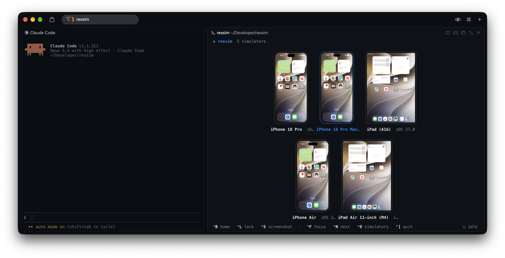

<h1 align="center">rexsim</h1>

<p align="center">iOS simulators in a <a href="https://www.superlogical.com/rex">Rex</a> pane, right next to your coding agent</p>



## Requirements

- Apple Silicon Mac
- Xcode with at least one iOS simulator
- [Bun](https://bun.sh) 1.4 or later
- [Rex](https://www.superlogical.com/rex)
- Meta's [idb_companion](https://github.com/facebook/idb), which rexsim downloads on first run

## Install

```sh
bun install
bun build src/main.ts --compile --outfile ~/.local/bin/rexsim
rexsim install
```

Open it in Rex with <kbd>⇧</kbd> <kbd>⌘</kbd> <kbd>I</kbd>

## Keys

| Key | Does |
| --- | --- |
| ⌃B | Home |
| ⌃L | Lock |
| ⌃S | Screenshot to the agent |
| ⌃F | Focus one simulator |
| ⌃N | Next simulator |
| ⌃O | Show or hide simulators |
| ⌃] | Quit |

MIT license. Third-party notices are in [THIRD_PARTY_NOTICES](THIRD_PARTY_NOTICES).
